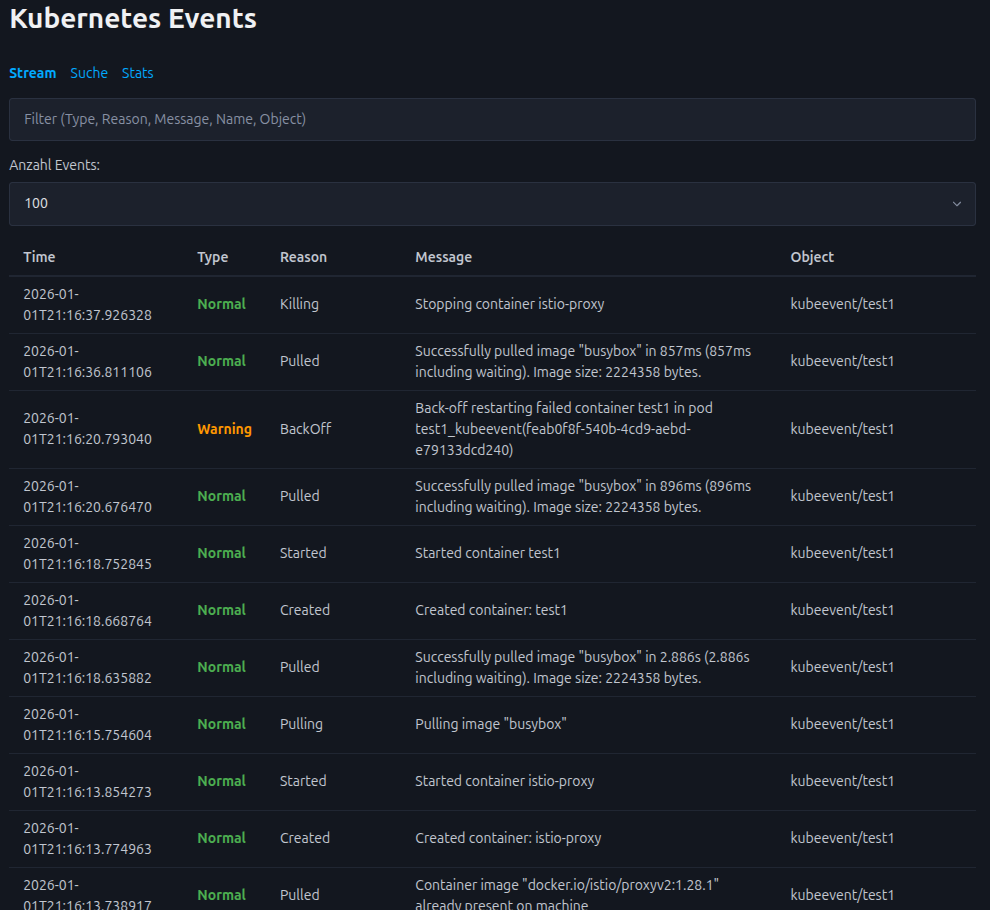
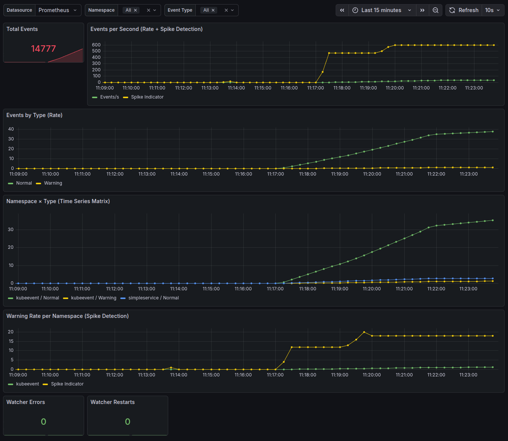
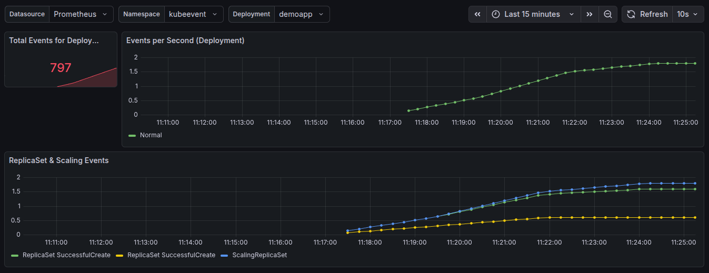
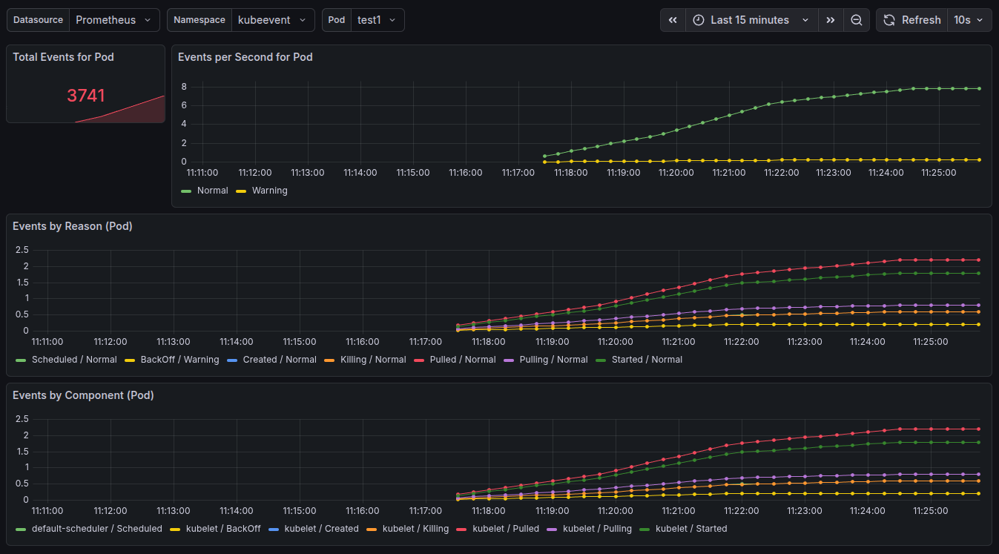

# 📡Kubernetes Event Dashboard
A lightweight, real‑time dashboard for collecting, storing, searching, and visualizing Kubernetes Events.
This project provides:
- A FastAPI backend that watches Kubernetes events, stores them in a database, and exposes REST + SSE endpoints
- A minimal frontend for live event streaming, searching, filtering, and pagination
- Prometheus metrics for monitoring event activity
- A clean, self‑contained solution for debugging clusters and understanding workload behavior



## Features
### Real‑time Event Stream
- Uses Kubernetes’ watch API
- Streams events via Server‑Sent Events (SSE)
- Live updates without page reloads
- Client‑side filtering (type, reason, message, namespace, involved object)

### Prometheus Metrics
Exposes /metrics with:
- Total events received
- Events by type (Normal, Warning, Error)
- Events by namespace
- Watcher errors

### Persistent Storage
- Stores all events in a SQLModel/SQLite (or any SQLModel‑compatible DB)
- Prevents event loss
- Allows historical search

## Architecture Overview
```
+-------------------+        +---------------------+
| Kubernetes API     | ----> | FastAPI Watcher     |
| (Events)           |       | (watcher.py)        |
+-------------------+        +---------------------+
                                    |
                                    v
                           +------------------+
                           | SQLModel Storage |
                           +------------------+
                                    |
                                    v
+-------------------+        +---------------------+
| Frontend (HTML/JS)| <----> | FastAPI REST + SSE  |
| Live Stream + UI  |        | /events/stream      |
+-------------------+        | /events/search      |
                             | /metrics            |
                             +---------------------+
```

## start from scratch
- uv lock --upgrade
- uv sync
- uv export --format requirements-txt --no-hashes --no-dev --no-emit-project -o requirements.txt
- cp .env-example .env
- uv run main.py (or `uv run uvicorn main:app --port 8001 --reload`)

## checks
- uv run ruff check .
- uv run pyright
- uv run pytest

## configuration
Settings come from environment variables or from `.env`. `.env-example` lists all of them with comments,
the code is in `kubeevents/config.py`.

| Variable | Default | Meaning |
|----------|---------|-----------|
| `DB_PATH` | `data/events.db` | Path to the SQLite file |
| `WATCH_NAMESPACES` | `demo` | Comma-separated list of watched namespaces |
| `POD_NAMESPACE` | | Former name of `WATCH_NAMESPACES`, only used if `WATCH_NAMESPACES` is empty |
| `RETENTION_DAYS` | `7` | The hourly retention job deletes older events |
| `METRICS_SERIES_TTL_HOURS` | `24` | Metric series without a new event for this long are removed from `/metrics` |
| `QUEUE_MAXSIZE` | `10000` | Buffer between the watchers and the DB worker |
| `BATCH_MAX_SIZE` | `500` | Maximum batch size of the DB worker (at most 2000) |
| `BATCH_MAX_DELAY` | `0.2` | Maximum time in seconds the DB worker collects a batch |
| `WATCH_TIMEOUT_SECONDS` | `300` | The API server ends a watch after this time, the watcher reconnects |
| `LOG_LEVEL` | `INFO` | Log level |
| `BASIC_AUTH_USER` | | User for HTTP Basic Auth. Auth is active when user and hash are set |
| `BASIC_AUTH_PASSWORD_HASH` | | bcrypt hash of the password. `/healthz`, `/readyz` and `/metrics` stay open |
| `HOST`, `PORT`, `RELOAD` | `0.0.0.0`, `8001`, `false` | Only used when starting with `uv run main.py` |

## basic auth
Create the hash with `uv run python -m kubeevents.auth` (asks for the password) or with
`htpasswd -nbBC 12 admin <password>` and take the part after `admin:`. The app checks bcrypt only on the first
request with valid credentials and remembers the result in memory.

## access ui and metrics
- http://localhost:8001
- http://localhost:8001/metrics


## run commands for local debugging in cluster
```bash
cd kubeevent-chart
helm install kubeevent . -n kubeevent --create-namespace

cd ..
curl -fsSL https://raw.githubusercontent.com/metalbear-co/mirrord/main/scripts/install.sh | bash

POD=$(kubectl get pod -n kubeevent -l app=kubeevent -o jsonpath='{.items[0].metadata.name}')

mirrord exec -t pod/$POD -n kubeevent  -- uv run uvicorn main:app --host 0.0.0.0 --port 8001 --reload
```

## create events
```bash
kubectl run test1 -n kubeevent --image=busybox -- echo hi
kubectl delete pod test1 -n kubeevent

kubectl create deployment demoapp -n kubeevent --image=nginx
kubectl scale deployment demoapp -n kubeevent --replicas=2
kubectl scale deployment demoapp -n kubeevent --replicas=0
kubectl delete deployment demoapp -n kubeevent
```

## Grafana Dashboard screenshots




## Docker build
```bash 
docker build -t kubeevent .

docker run --rm \
  --name kubeevent \
  -p 5000:5000 \
  -v $(pwd)/data:/app/data \
  -v $HOME/.kube/config:/home/appuser/.kube/config:ro \
  -e WATCH_NAMESPACES=kubeevent,randomfail \
  -e DB_PATH=/app/data/events.db \
  kubeevent
```